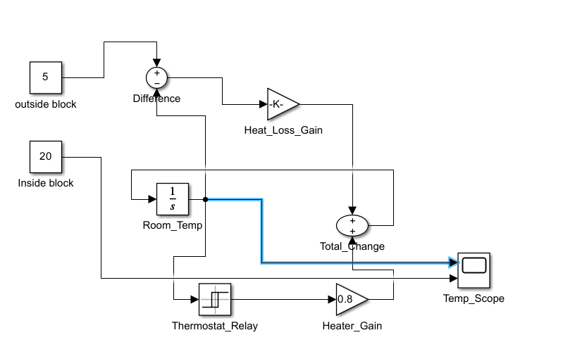
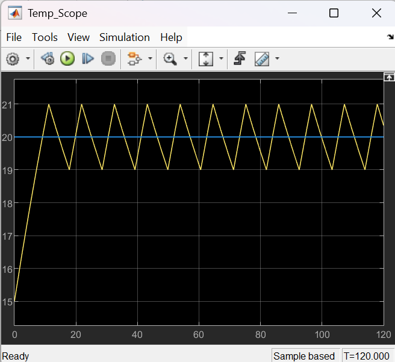

Closed-Loop Thermostat Control in Simulink
==========================================

A closed-loop room temperature control simulation built in MATLAB/Simulink using a thermal energy balance and a hysteresis relay controller.

Simulink Block Diagram
----------------------

How the Model Works
-------------------

The model calculates how fast the room temperature changes over time by combining two things: heat escaping to the cold outside air and heat added by the heater.

Rate of Temperature Change = 0.02 x (Outside Temp - Room Temp) + 0.8 x Heater Signal

Blocks Used in the Model:

1. outside block (Constant = 5): Cold outdoor air temperature (5 °C).
2. Inside block (Constant = 20): Target room temperature reference line (20 °C).
3. Room_Temp (Integrator, Initial Condition = 15): Starts the room at 15 °C and tracks room temperature over time.
4. Difference (Sum, signs + -): Subtracts room temperature from outside temperature.
5. Heat_Loss_Gain (Gain = 0.02): Controls how fast heat leaks out through the walls.
6. Thermostat_Relay (Relay): Turns the heater ON (1) below 19 °C and OFF (0) above 21 °C so the switch does not flicker rapidly.
7. Heater_Gain (Gain = 0.8): Heating speed when the heater is turned ON.
8. Total_Change (Sum, signs + +): Adds heat loss and heater input together and loops back into Room_Temp.
9. Temp_Scope (Scope, 2 inputs): Plots actual room temperature against the 20 °C target over 120 minutes.

Simulation Result (120 Minutes)
-------------------------------

1. Initial warm-up: Starting at 15 °C, the heater turns ON right away and warms the room up to 21 °C.
2. Steady temperature control: At 21 °C, the thermostat turns the heater OFF and the room slowly cools toward the 5 °C outside air until it reaches 19 °C, where the heater switches back ON. This keeps the room comfortably between 19 °C and 21 °C around the 20 °C target.

How to Run
----------

1. Open Thermostat_Control.slx in MATLAB / Simulink.
2. Set Stop Time to 120 and click Run.
3. Double-click Temp_Scope to view the temperature graph.
